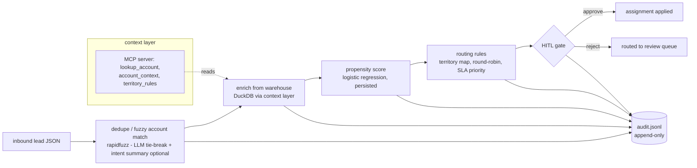

# feat: Autonomous revenue engine interview demo slice

## Summary

A self-contained, offline-safe demo of a miniature "autonomous revenue engine" for Robi's LeanData GTM Engineer (Data & AI) interview (Mon 2026-08-10): a DuckDB mini-warehouse with believable synthetic data, an MCP server exposing it as a context layer, a logistic-regression propensity score, and one agentic lead-routing workflow that blends LLM judgment (with deterministic fallbacks) with deterministic rules, a human-in-the-loop gate, and an append-only audit trail. One command replays an inbound lead end to end in under 5 minutes.

**Done sentence:** `pytest` passes and one command replays an inbound lead through enrich → score → route with a visible audit trail, demoable in under 5 minutes.

---

## Problem Frame

The LeanData JD (evaluation: `~/Downloads/career-ops/reports/131-leandata-2026-07-06.md`) asks for a unified data layer + APIs/MCPs + agentic workflows blending AI reasoning with deterministic logic + scoring/propensity models. Robi's three defendable gaps are warehouse depth, formal predictive modeling, and years-in-title. A small working artifact that *is* the JD closes all three with evidence. The demo must never die on stage: zero paid APIs required, zero network calls at demo time, LLM steps degrade gracefully to deterministic fallbacks.

---

## Requirements

- **R1** — DuckDB warehouse with a star schema: `accounts`, `contacts`, `activities`, `opportunities`; seeded synthetic data with a coherent cross-table story (no lorem-ipsum names; activity patterns correlate with opportunity outcomes so the model learns real signal).
- **R2** — MCP server (Python, official `mcp` SDK) exposing read tools over the warehouse: account lookup, account context (contacts + activity history), territory rules.
- **R3** — Propensity score: logistic regression trained on synthetic opportunity outcomes, persisted to disk, deterministic (fixed seeds), documented in an honest model card.
- **R4** — Agentic routing workflow: inbound lead JSON → dedupe/fuzzy account match → enrich from warehouse → score → deterministic routing rules (territory map, round-robin, SLA/priority) with LLM used ONLY for judgment steps (messy company-name tie-breaks, intent summary) behind deterministic guardrails and an HITL gate before any assignment fires.
- **R5** — Append-only JSONL audit trail: every stage decision with inputs, decision, rule fired, and whether a fallback was used.
- **R6** — pytest suite covering schema integrity, scoring determinism, routing rules, guardrails/fallbacks, and the HITL gate.
- **R7** — Offline-safe: with no API key present, the full demo runs identically via deterministic fallbacks; no network calls at demo time.

---

## Scope Boundaries

**In scope:** everything in R1–R7, one demo CLI entrypoint, README demo script.

**Out of scope (product identity):** real CRM integrations, real lead data, deploys, external sends of any kind.

**Deferred to follow-up work:** demo dashboard/UI — deliberately excluded here; that surface gets separate gauntlet rounds (blind-critic loop) after this repo is Finn-verified. Optional: richer models (gradient boosting), write-tools on the MCP server.

---

## Key Technical Decisions

- **KTD1** *(session-settled: user-directed — chosen over Postgres: zero-install, single-file, demo-portable)* — **DuckDB** for the warehouse. Ships as a file in-repo; no daemon to fail on stage.
- **KTD2** *(session-settled: user-directed — chosen over Node: Python-first constraint, sklearn adjacency)* — **Python throughout**, official `mcp` Python SDK (FastMCP server pattern), `scikit-learn` for the model, `rapidfuzz` for fuzzy matching.
- **KTD3** *(session-settled: user-directed — chosen over "always-LLM": demo must never die on stage)* — **LLM-optional architecture**: judgment steps call Anthropic only when `ANTHROPIC_API_KEY` is present AND `--llm` is passed; otherwise a deterministic fallback (rapidfuzz threshold policy; keyword intent rules) produces the same output shape. Audit records `fallback_used: true/false`.
- **KTD4** — **Seeded determinism everywhere**: one `RANDOM_SEED` constant governs synthetic data generation and model training so tests can assert exact behavior and the demo is replayable.
- **KTD5** — **Audit as JSONL append-only file** (`runs/audit.jsonl`), one record per stage decision, hash of inputs included — cheap, greppable on stage, and demonstrates the "evidence culture" talking point.
- **KTD6** — **HITL gate as a two-step CLI**: the pipeline halts at `pending_approval` with the proposed assignment; `--approve` (or interactive `y`) applies it. Mirrors LeanData's routing-with-guardrails story.

---

## High-Level Technical Design



The MCP server and the pipeline share one warehouse-access module — the MCP server is a *view* over the same context layer the pipeline uses, which is the JD's "unified data layer" claim made concrete.

---

## Output Structure

```text
leandata-revenue-engine-demo/
├── pyproject.toml
├── README.md                      # 5-minute demo script, architecture blurb
├── data/
│   ├── inbound/                   # 3 sample lead JSONs (clean, messy-name, no-match)
│   └── seed/
│       └── warehouse.duckdb       # (generated by warehouse.py --rebuild)
├── src/revenue_engine/
│   ├── config.py                  # RANDOM_SEED, paths, territory map
│   ├── warehouse.py               # schema DDL + synthetic seed + query helpers
│   ├── features.py                # feature extraction (shared by train + score)
│   ├── model.py                   # train, persist, load, score
│   ├── matching.py                # dedupe/fuzzy match + LLM tie-break + fallback
│   ├── routing.py                 # deterministic rules: territory, round-robin, SLA
│   ├── audit.py                   # append-only JSONL writer
│   ├── pipeline.py                # orchestrates match→enrich→score→route→gate
│   ├── demo.py                    # CLI entrypoint (python -m revenue_engine.demo)
│   └── mcp_server.py              # FastMCP read tools over warehouse
├── models/
│   ├── propensity.joblib          # persisted model (generated)
│   └── model_card.md              # honest feature docs, metrics, limitations
├── runs/                          # audit.jsonl + round-robin state (generated)
└── tests/
    ├── test_warehouse.py
    ├── test_model.py
    ├── test_matching.py
    ├── test_routing.py
    ├── test_pipeline.py
    └── test_mcp_server.py
```

---

## Implementation Units

### U1. Warehouse schema + synthetic seed

**Goal:** DuckDB star schema with believable, internally coherent synthetic data.
**Requirements:** R1, R6 (warehouse test slice), R7. Implements KTD1, KTD4.
**Dependencies:** none.
**Files:** `src/revenue_engine/config.py`, `src/revenue_engine/warehouse.py`, `tests/test_warehouse.py`, `pyproject.toml`.
**Approach:** DDL for `accounts` (~40 rows: name, domain, industry, employee_band, country/state, territory), `contacts` (~120), `activities` (~600: type, ts, contact_id), `opportunities` (~80: stage, amount, outcome won/lost, closed_at). Generator uses one fixed seed and *injects real signal*: won opportunities correlate with higher 30-day activity counts and more distinct engaged contacts. Company/person names from curated fictional lists (no "Test Corp", no lorem ipsum). Territory map lives in `config.py` (AMER-East, AMER-West, EMEA, APAC with rep rosters).
**Test scenarios:** seed is deterministic (two runs produce identical row hashes); FK integrity (no orphan contacts/activities/opportunities); row counts in expected bands; signal check (mean activity count of won-opp accounts > lost-opp accounts); every account maps to exactly one territory.
**Verification:** `pytest tests/test_warehouse.py` green; `warehouse.py --rebuild` produces `data/seed/warehouse.duckdb` from scratch.

### U2. Propensity model + model card

**Goal:** Trained, persisted, deterministic logistic-regression propensity score with honest documentation.
**Requirements:** R3, R6 (model test slice), R7. Implements KTD4.
**Dependencies:** U1.
**Files:** `src/revenue_engine/features.py`, `src/revenue_engine/model.py`, `models/model_card.md`, `tests/test_model.py`.
**Approach:** Features: activity_count_30d, distinct_contacts_engaged, days_since_last_activity, prior_opportunity_count, employee_band (ordinal), industry_fit (binary from config list). **As-of semantics prevent leakage:** training rows compute every feature as of that opportunity's creation date (e.g., activities in the 30 days *before* opp creation); live scoring computes the same features as of now. `features.py` defines defaults for structurally-absent values (counts → 0; days_since_last_activity → documented cap of 365) so any matched account is scorable; the clear-error path is reserved for malformed input dicts. Train on opportunity outcomes; persist with joblib; `score(features) -> 0..1`. Model card states features, the as-of design, training-set size, holdout AUC, and limitations plainly (synthetic data, tiny n, illustrative only) — the honesty is a deliberate interview talking point.
**Test scenarios:** training is deterministic (same coefficients across runs); holdout AUC > 0.65 (signal injected in U1 is learnable); no training feature uses activity timestamped after its opportunity's creation date (leakage guard); a matched account with zero activities/opportunities scores without error via defaults; score is pure (same input → same output, no I/O); malformed input dict raises a clear error; model card exists and lists every feature used in `features.py`.
**Verification:** `pytest tests/test_model.py` green; `python -m revenue_engine.model --train` regenerates `models/propensity.joblib`.

### U3. Matching + routing + audit (deterministic core)

**Goal:** The non-LLM spine: fuzzy account matching, deterministic routing rules, append-only audit.
**Requirements:** R4 (deterministic half), R5, R6 (matching/routing test slice). Implements KTD5.
**Dependencies:** U1.
**Files:** `src/revenue_engine/matching.py`, `src/revenue_engine/routing.py`, `src/revenue_engine/audit.py`, `tests/test_matching.py`, `tests/test_routing.py`.
**Approach:** Matching: normalize (lowercase, strip suffixes like Inc/LLC), rapidfuzz token-set ratio against account names + exact domain match shortcut; policy: ≥90 auto-match, 70–89 ambiguous (→ judgment step in U4), <70 no-match (new-account path). Routing: territory from lead country/state via config map → round-robin among that territory's reps (counter persisted in `runs/`) → SLA priority tier from score (≥0.7 = P1/15-min SLA, else P2). Audit: `audit.append(stage, lead_id, inputs, decision, rule_fired, fallback_used)` writing JSONL with input hash + ISO timestamp.
**Test scenarios:** exact-domain lead matches instantly; "Ledgerlyne Inc." fuzzy-matches "Ledgerline" above threshold; below-70 input returns no-match; round-robin distributes 6 sequential leads 2/2/2 across a 3-rep territory and persists across process restarts; unknown country routes to default territory with `rule_fired: fallback_territory`; every routing decision produces exactly one audit line; audit file is append-only (second run appends, never truncates).
**Verification:** `pytest tests/test_matching.py tests/test_routing.py` green.

### U4. Agentic pipeline: LLM judgment steps, guardrails, HITL gate

**Goal:** The full workflow wired end to end with optional LLM judgment and a blocking human gate.
**Requirements:** R4, R5, R6 (pipeline/guardrail test slice), R7. Implements KTD3, KTD6.
**Dependencies:** U2, U3.
**Files:** `src/revenue_engine/pipeline.py`, `src/revenue_engine/demo.py`, `data/inbound/lead_001.json` (clean), `lead_002.json` (messy name → judgment step), `lead_003.json` (no match), `tests/test_pipeline.py`.
**Approach:** `pipeline.run(lead_path, llm=False)` orchestrates match → enrich (warehouse context) → score → route → gate. Two decoupled judgment steps: (a) company-name tie-break fires only in the 70–89 ambiguous match band; (b) one-line intent summary fires for any lead with non-empty free-text notes — so every demo lead exercises the AI-with-guardrails story. `demo.py` supports `--fresh`: clears `runs/` round-robin state (never the audit log) before the run so rehearsal and live demo produce identical assignments; the README script leads with it. With `--llm` + `ANTHROPIC_API_KEY`: call Anthropic with a constrained prompt (choose from candidate list only / summarize ≤20 words); any error, timeout, or out-of-bounds response falls through to the deterministic fallback (highest rapidfuzz score; keyword intent rules) — the LLM can never expand its own action space. Without the flag/key: fallback path runs directly. Gate: pipeline writes `pending_approval` audit record and prints the proposed assignment; `--approve` (or interactive confirm) writes `assignment_applied`; rejection writes `routed_to_review`. **Execution note:** verify the no-network guarantee with a test that runs the full pipeline with sockets blocked.
**Test scenarios:** clean lead runs end to end offline, gets an intent summary via keyword fallback (`fallback_used: true` on that stage when no key present), no `pending` leak; two `--fresh` runs of the same lead produce identical assignments (replayability); messy-name lead triggers the tie-break judgment step and resolves via fallback when no key present (`fallback_used: true` in audit); LLM mock returning an out-of-candidate-list answer is rejected and fallback fires (guardrail); pipeline with sockets disabled completes fully (offline guarantee); assignment is NOT applied without approval (gate blocks); `--approve` applies and audits it; no-match lead exits via new-account path with audit record; every stage of a full run appears in audit in order.
**Verification:** `pytest tests/test_pipeline.py` green offline; `python -m revenue_engine.demo data/inbound/lead_002.json` prints staged run + audit tail in <30s.

### U5. MCP server + README demo script

**Goal:** The context layer exposed as MCP tools, plus the 5-minute demo script.
**Requirements:** R2, R6.
**Dependencies:** U1 (tools read warehouse), U2 (account_context serves the current score), U4 (README narrates full flow).
**Files:** `src/revenue_engine/mcp_server.py`, `tests/test_mcp_server.py`, `README.md`.
**Approach:** FastMCP server with three read tools: `lookup_account(query)` (name or domain → id + summary), `account_context(account_id)` (contacts, last-10 activities, open opportunities, current score), `territory_rules()` (map + rosters + SLA tiers). Tools call the same `warehouse.py` helpers the pipeline uses — one context layer, two consumers. README: quickstart (`uv sync` or `pip install -e .`, rebuild, train, run demo), the 5-minute demo script (which lead to run, what to say at each stage, where the audit trail is), architecture paragraph mapping each component to the JD's language.
**Test scenarios:** each tool invoked in-process returns the documented shape; `lookup_account` on a fuzzy name returns ranked candidates; `account_context` on an invalid id returns a structured error (not a traceback); server module imports and registers exactly 3 tools.
**Verification:** `pytest tests/test_mcp_server.py` green (the binding automated gate — in-process registration + tool-shape tests); README demo script executed start-to-finish once by the implementer in under 5 minutes. `mcp dev src/revenue_engine/mcp_server.py` is an optional manual smoke-check only (requires `mcp[cli]` + Node/npx and may fetch the Inspector over the network) — excluded from automated pass criteria.

---

## Verification Contract

- `pytest` — full suite green, offline, from a fresh clone after the documented setup commands.
- `python -m revenue_engine.demo data/inbound/lead_002.json` — full staged replay incl. judgment fallback + HITL gate, no network, <30s.
- Determinism spot-check: two consecutive `--rebuild && --train` cycles produce identical model coefficients and identical seed row-hashes.
- No file in `src/` imports `anthropic` at module top level (lazy import inside the guarded LLM path only) — protects the offline guarantee.

## Definition of Done

All Verification Contract gates pass; README demo script is accurate against the shipped behavior; audit JSONL from a demo run shows every stage with rule fired and fallback flags; repo is clean (no generated artifacts committed except `data/seed/warehouse.duckdb`, `models/propensity.joblib`, and `model_card.md`, which ship for zero-setup demos — the committed warehouse must match a fresh `--rebuild` by row hashes).

---

## Risks & Dependencies

- **Time risk (interview Mon):** U1–U4 are the demo-critical path; U5's MCP server is the JD's keyword but the demo survives without it live (talk track can show the code). Finn should land units in order.
- **Dependency drift:** pin exact versions of ALL runtime deps in `pyproject.toml` (`mcp`, `scikit-learn`, `duckdb`, `rapidfuzz`, `joblib`) — the committed `propensity.joblib` is version-coupled to the pinned scikit-learn; tools are tested in-process so the demo doesn't depend on client tooling.
- **Synthetic-data credibility:** guarded by U1's signal test and curated name lists; critic eyes come later via the separate gauntlet pass on any UI.
- **Sockets-blocked test portability (macOS):** if socket-blocking proves flaky, substitute an "assert no `anthropic` client constructed" spy — the guarantee, not the mechanism, is the requirement.

## Open Questions (deferred to implementation)

- Exact rapidfuzz scorer choice (token_set vs partial) — pick whichever passes the U3 scenarios most naturally.
- Whether `runs/` round-robin state is JSON or a DuckDB table — implementer's call; tests assert behavior, not storage.
